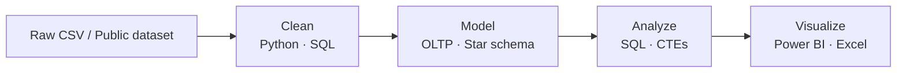

 

 Laguna, Philippines &nbsp;•&nbsp;  B.S. Information Technology &nbsp;•&nbsp;  Open to Data Analyst / Data Engineer internships

 

---

## 👋 About Me

I'm a 4th-year Information Technology student in Laguna, Philippines, teaching myself data analytics and data engineering, and I'm actively looking for an internship where I can work with real data and learn from a team.

I like the unglamorous half of the job: fixing the data before anyone asks a question of it. So far I've untangled mixed date formats and duplicate orders with SQL CTEs, normalized a 100,000-row flat table into a relational schema, and modeled Google's public e-commerce data into a star schema in BigQuery. I've also scraped and analyzed 682 Philippine job listings to see where entry-level opportunities actually are. Most of my projects end in something a person can open and use, usually a Power BI or Excel dashboard.

I learn by building complete projects instead of isolated exercises. Each one takes a raw dataset through cleaning, modeling, analysis, and a dashboard, and I write up what I found along the way. I'm still growing, and I'm currently building an automated pipeline for Philippine inflation (CPI) data, from ingestion to dashboard, to practice the data engineering side end to end.

**What I'm looking for:** a data analyst or data engineering internship where I can put my learnings and skill into real world scenarios.

> 💬 Ask me about SQL data cleaning, schema design, ETL pipelines, or Power BI dashboards.

### How my projects flow

---

##  Tech Stack

  
  
  
  
  
  
  
  
  
  

|  Analysis |  Data Engineering |  Visualization |
|---|---|---|
| Data cleaning | ETL / ELT pipelines | Power BI |
| Exploratory data analysis | Normalization (1NF to 3NF) | Looker Studio |
| SQL (CTEs, window functions) | Star schema, OLTP / OLAP | Excel dashboards |
| Pandas | ERD design, data validation | Pivot Tables, VLOOKUP, SUMIF / COUNTIF |

---

##  Featured Projects

###  Analytics and Dashboards

<table>
<tr>
<td width="50%" valign="top">

#### [Company Insights ETL Dashboard](https://github.com/Rui-Manalo/company-insights-etl-dashboard)
Full pipeline from a messy 9,980-row CSV to an interactive Power BI dashboard.

**Finding:** culture and work-life balance set top-rated companies apart, while pay showed little relationship to overall rating.

`Python` `MySQL` `Power BI`

</td>
<td width="50%" valign="top">

#### [2026 Prosple Job Listing Analysis](https://github.com/Rui-Manalo/2026_Prosple_Job_Listing_Analysis)
End-to-end analysis of 682 scraped Philippine job listings: cleaning, SQL analysis, and a dashboard.

**Finding:** NCR accounts for 311 listings, and remote roles consistently pay more than onsite ones.

`Excel` `Python` `MySQL` `Power BI`

</td>
</tr>
<tr>
<td width="50%" valign="top">

#### [Netflix Movie and TV Shows Analysis](https://github.com/Rui-Manalo/NetflixMovie-and-TVshows-Analysis)
Turned a messy Kaggle dataset into a Power BI dashboard, from Excel profiling to Python cleaning.

**Finding:** Drama dominates the catalog by volume (3,744 titles).

`Excel` `Python` `Power BI`

</td>
<td width="50%" valign="top">

#### [Tech Layoffs 2026 Analysis Report](https://github.com/Rui-Manalo/Tech_Layoffs_2026_Analysis_Report)
A 10-question SQL investigation into tech layoffs, hiring trends, and AI replacement risk by industry.

`MySQL` `CTEs` `Power BI`

</td>
</tr>
<tr>
<td width="50%" valign="top">

#### [E-commerce SQL Data Cleaning](https://github.com/Rui-Manalo/E-commerce_SQL_Data_Cleaning)
Rebuilds a messy orders export into one trustworthy table using a chain of CTEs: standardized columns, fixed types, mixed date formats parsed, duplicates removed, categories normalized.

`SQL` `CTEs` `Window functions`

</td>
<td width="50%" valign="top">

#### [Excel Superstore Sales Analysis](https://github.com/Rui-Manalo/excel-superstore-salesAnalysis)
An Excel-native sales dashboard a small business owner could open and use without any other tool.

`Excel` `Pivot Tables` `Named ranges`

</td>
</tr>
</table>

###  Data Engineering and Modeling

| Project | What it does | Stack |
|---|---|---|
| [**StreamFlix: OLTP to OLAP**](https://github.com/Rui-Manalo/oltp-to-olap-dimensional-modeling) | Takes a flat movie-streaming dataset through functional dependency analysis, normalization into an OLTP schema, and a star-schema warehouse with ETL and validation. | `SQL` |
| [**TheLook E-Commerce Star Schema**](https://github.com/Rui-Manalo/TheLook-E-Commerce-Star-Schema-Sales-Dashboard) | Models Google's public e-commerce dataset into a star schema (grain: one row per line item sold) and builds a sales dashboard on top. | `BigQuery` `Power BI` |
| [**Student Exam Performance Data Modeling**](https://github.com/Rui-Manalo/student-exam-performance-data-modeling) | Normalizes a 100,000-row flat table into a relational schema with an ERD and a SQL ETL pipeline. | `SQL` |
| [**Music Database Schema Design**](https://github.com/Rui-Manalo/music-catalog-schema-design) | Relational schema for artists, albums, songs, and genres, including a many-to-many resolution, built in DuckDB. | `DuckDB` `draw.io` |

###  Python Practice

| Project | What it does |
|---|---|
| [**Messy Employees Data Cleaning**](https://github.com/Rui-Manalo/messy_employees_dataCleaning_Python) | pandas script that cleans a raw HR export: standardizes categories, parses mixed dates, removes duplicates, and handles missing values. |
| [**Mall Customers Analysis**](https://github.com/Rui-Manalo/mall-customers-analysis) | Exploratory analysis and visualization of customer behavior using a Kaggle dataset. |

---

##  Currently Building

**PSA CPI Pipeline:** an automated workflow from data ingestion to presentation, using Philippine Statistics Authority consumer price index (inflation) data with MySQL, Python, and Power BI.

---

##  Certifications

| Certification | Issuer | Date |
|---|---|---|
| Data Analysis with Python | freeCodeCamp | Aug 2026 |
| Data Analytics Essentials | Cisco Networking Academy | Jul 2026 |
| Introduction to Data Science | Cisco Networking Academy | Apr 2026 |
| Python Essentials 1 | Cisco Networking Academy | Mar 2026 |

---

### 🤝 Let's Connect

Open to **Data Analyst** and **Data Engineer** opportunities.

Thanks for stopping by. Check out my repos for the full projects.

